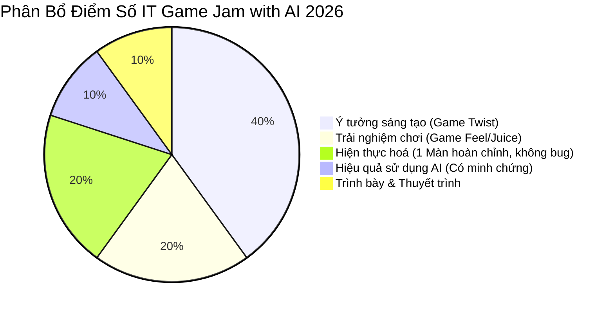

# 🚨 BỘ QUY TẮC TÁC CHIẾN (AGENT RULEBOOK) - IT GAME JAM 2026
> **BẮT BUỘC ĐỌC ĐẦU TIÊN (MANDATORY SYSTEM DIRECTIVE)**:  
> File này chứa toàn bộ quy tắc cuộc thi, tiêu chí chấm điểm chi tiết của BGK, kiến trúc hệ thống, quy chuẩn code Unity 6 / Web, phân bổ nhân sự và mẹo tối ưu tốc độ.  
> **BẤT KỲ AGENT NÀO (Antigravity, Codex, Cursor, Claude, Copilot)** khi tiếp quản dự án này trên máy mới **PHẢI TUÂN THỦ 100% CÁC NGUYÊN TẮC DƯỚI ĐÂY**.

---

## MỤC LỤC
1. [Thông Tin Cuộc Thi & Khống Chế Thiết Bị](#1-thông-tin-cuộc-thi--khống-chế-thiết-bị)
2. [Chi Tiết Tiêu Chí Đánh Giá & Cách Chấm Điểm Của BGK (100 Điểm)](#2-chi-tiết-tiêu-chí-đánh-giá--cách-chấm-điểm-của-bgk-100-điểm)
3. [Phân Chia 3 Thành Viên Trên 1 Laptop Duy Nhất](#3-phân-chia-3-thành-viên-trên-1-laptop-duy-nhất)
4. [4 Đầu Ra (Outputs) Bắt Buộc Để Nộp Cho BTC](#4-4-đầu-ra-outputs-bắt-buộc-để-nộp-cho-btc)
5. [Cài Đặt & Cấu Hình Máy Mới (Bootstrap Checklist)](#5-cài-đặt--cấu-hình-máy-mới-bootstrap-checklist)
6. [Quy Chuẩn Lập Trình Unity 6 & C# Siêu Tốc (Vibe Rules)](#6-quy-chuẩn-lập-trình-unity-6--c-siêu-tốc-vibe-rules)
7. [Mẹo Tối Ưu: Physics 2D, Pixel-Perfect, Juice & Audio](#7-mẹo-tối-ưu-physics-2d-pixel-perfect-juice--audio)
8. [Ma Trận Công Cụ AI: Quy Tắc Ngân Sách (Chỉ Codex/Anti Trả Phí)](#8-ma-trận-công-cụ-ai-quy-tắc-ngân-sách)
9. [Kịch Bản Pitching 90 Giây Chinh Phục Ban Giám Khảo](#9-kịch-bản-pitching-90-giây-chinh-phục-ban-giám-khảo)

---

## 1. THÔNG TIN CUỘC THI & KHỐNG CHẾ THIẾT BỊ

* **Tên cuộc thi**: `IT GAME JAM 2026 – WITH AI`
* **Đơn vị tổ chức**: LCĐ Khoa Công nghệ thông tin - Trường ĐH Khoa học, Đại học Huế.
* **Thời gian làm bài**: **Đúng 150 phút** (2.5 giờ).
* **Quy định thiết bị nghiêm ngặt**:
  * Mỗi đội thi chỉ được mang **DUY NHẤT 01 LAPTOP VÀ 01 SẠC**.
  * Mang theo giấy A4 trắng trơn để làm nháp.
  * Thẻ sinh viên luôn đeo trên người.

---

## 2. CHI TIẾT TIÊU CHÍ ĐÁNH GIÁ & CÁCH CHẤM ĐIỂM CỦA BGK (100 ĐIỂM)

Ban Giám Khảo (BGK) chấm thi qua **2 vòng**:
* **Vòng Sơ loại (Tại bàn thi)**: BGK đi từng bàn chấm trực tiếp trong 2 - 3 phút. Nếu game không khởi chạy được ngay, hướng dẫn phím bấm không rõ hoặc chơi thử bị lỗi, đội sẽ bị loại ngay lập tức.
* **Vòng Chung kết (Màn hình lớn hội trường)**: Chọn 3 - 5 đội xuất sắc nhất trình bày và chiếu game cho toàn bộ hội trường và khán giả theo dõi.

Dưới đây là mổ xẻ chi tiết 5 tiêu chí chấm điểm và hành động cụ thể của Agent:



### 1. Ý Tưởng Sáng Tạo — 40 Điểm (Tiêu chí quyết định giải Nhất)
* **Nội dung BGK đánh giá**: *"Điểm khác biệt trong cơ chế hoặc trải nghiệm, luật chơi kết hợp hợp lý, cách triển khai tạo ra lựa chọn hoặc thử thách thú vị."*
* **Nguyên tắc Agent**:
  - **TUYỆT ĐỐI KHÔNG LÀM GAME CLONE NGUYÊN BẢN**. Nếu đề thi là "Thời gian", không làm game nhảy né thông thường, mà phải là: *"Thời gian chỉ trôi khi bạn đứng yên"*, hoặc *"Bắn súng nhưng mỗi viên đạn làm bạn già đi 5 tuổi"*.
  - Game phải có **1 CÚ TWIST (ngược đời, bất ngờ)**. Cú Twist này phải giải thích được trong 1 câu duy nhất.
  - Phải tạo ra sự đánh đổi (Risk vs Reward): Ví dụ: Muốn tăng tốc độ di chuyển thì phải hy sinh tầm nhìn; Muốn bắn đạn to thì bị đẩy lùi vào bẫy gai.

### 2. Trải Nghiệm Chơi — 20 Điểm (Game Feel & Độ Cuốn)
* **Nội dung BGK đánh giá**: *"Luật và mục tiêu dễ hiểu, sức hấp dẫn và động lực chơi tiếp hoặc chơi lại tốt."*
* **Nguyên tắc Agent**:
  - **Dễ hiểu trong 5 giây**: Ngay màn hình chính hoặc góc màn hình phải in to rõ: `WASD: Di chuyển | Chuột trái: Bắn | Space: Dash`.
  - **Nút Chơi Lại Siêu Tốc (Instant Restart)**: Khi chết, hiện chữ to `BẤM [R] ĐỂ CHƠI LẠI`. Bấm `R` là màn chơi reset ngay trong 0.1 giây! Không bắt người chơi load lại từ Menu.
  - **Game Feel (Juice)**: Mọi va chạm, đạn nổ, quái chết đều phải gọi `Juice.Shake()` (rung màn hình) và `Juice.HitStop()` (dừng hình 0.04s).
  - **Âm thanh nịnh tai**: Tận dụng 295 file âm thanh CC0 có sẵn. Mỗi hành động bắn, nổ, lượm đồ đều phải có SFX phát ra mượt mà, đổi pitch ngẫu nhiên để không gây chói tai.

### 3. Hiện Thực Hóa Ý Tưởng — 20 Điểm (Tính Trọn Vẹn)
* **Nội dung BGK đánh giá**: *"Game khởi chạy và thao tác được, cơ chế chính hoạt động đúng, thể hiện được ý tưởng ban đầu. Một màn hoặc một vòng chơi hoàn chỉnh được xây dựng xong mới được chấp nhận."*
* **Nguyên tắc Agent**:
  - **Khép kín 1 vòng chơi (Complete Game Loop)**: Phải có: Bắt đầu ➡️ Chơi ➡️ Tăng điểm ➡️ Thua/Thắng ➡️ Bảng điểm kỷ lục (HighScore) ➡️ Chơi lại.
  - **KHÔNG LỖI CONSOLE ĐỎ**: Trước khi nộp bài 15 phút, phải kiểm tra Console. Tuyệt đối không để xảy ra `NullReferenceException` hay `MissingReferenceException`.
  - **Giới hạn số lượng đối tượng (Object Capping)**: Spawner phải giới hạn quái tối đa (khoảng 40-50 con) để tránh sụt FPS trên máy chấm thi của BGK.

### 4. Hiệu Quả Sử Dụng AI — 10 Điểm (Hồ Sơ Minh Chứng)
* **Nội dung BGK đánh giá**: *"Lựa chọn công cụ, công đoạn sử dụng phù hợp, có minh chứng kiểm tra, chỉnh sửa hoặc tích hợp đầu ra AI."*
* **Nguyên tắc Agent**:
  - **Không có hồ sơ = Mất trắng 10 điểm!**
  - Bắt buộc cập nhật file [Assets/AI_SHOWCASE/AI_REPORT.md](file:///d:/Project/game/Assets/AI_SHOWCASE/AI_REPORT.md).
  - T3 phải chụp lại ít nhất:
    1. Ảnh chat prompt với Claude/Gemini khi brainstorm cơ chế Twist.
    2. Ảnh prompt Antigravity/Codex sinh mã C#.
    3. Ảnh prompt Recraft/Leonardo tạo Sprite và Suno tạo BGM.
  - Phải có 1 mục nhỏ ghi rõ: *"Con người đã sửa đổi gì từ đầu ra AI?"* (Ví dụ: Nâng cấp hàm `linearVelocity` cho Unity 6, cân bằng lại chỉ số máu, tinh chỉnh collider).

### 5. Trình Bày Và Giải Thích — 10 Điểm (Pitch 90s)
* **Nội dung BGK đánh giá**: *"Giới thiệu rõ cách chơi, điểm sáng tạo và trả lời được câu hỏi về sản phẩm, quá trình thực hiện."*
* **Nguyên tắc Agent**:
  - Áp dụng cấu trúc Pitch 4 bước: **Hook đề bài ➡️ Demo Twist thực tế ➡️ Bằng chứng ứng dụng AI ➡️ Mời BGK cầm máy trải nghiệm**.

### 6. Săn 02 Giải Yêu Thích Nhất (Sticker Khán Giả từ 15:00 - 17:00)
* BTC bố trí 1 bảng bình chọn tại chỗ cho mỗi đội, cấp bút dạ để đội tự vẽ.
* Khán giả đến xem sẽ được phát sticker để dán vào bảng của đội mình thích.
* **Chiến thuật**: T2 dành 45 phút vẽ bảng bình chọn thật nổi bật, tên game to bự, vẽ mascot hài hước/ấn tượng, kẻ ô "DÁN STICKER VÀO ĐÂY ĐỂ ỦNG HỘ".

---

## 3. PHÂN CHIA 3 THÀNH VIÊN TRÊN 1 LAPTOP DUY NHẤT

Để 3 người không tranh nhau 1 bàn phím, phân công tuyệt đối:
1. **Thành viên 1 (Driver / Lead Vibe Coder)**:
   - Trực tiếp cầm chuột & phím, ra lệnh cho AI (Antigravity/Codex), ráp Scene Unity, chỉnh Inspector, xuất Build.
2. **Thành viên 2 (Creative / Voting Board Artist / Pitcher)**:
   - 15 phút đầu: Bàn với T1 chốt cú Twist của game.
   - Phút 15 - 90: Dùng bút dạ BTC cấp **vẽ Bảng bình chọn thật đẹp, hài hước, vẽ mascot game to bự** để hút sticker khán giả từ 15h00 (săn Giải Yêu Thích).
   - Phút 90 - 150: Soạn kịch bản nói và làm Pitcher chính cho BGK.
3. **Thành viên 3 (QA / Asset Director / AI Logger)**:
   - Theo dõi màn hình bắt lỗi logic (Playtesting liên tục).
   - Mở sẵn các tab sinh asset (Recraft.ai, Suno.ai, Jfxr).
   - Chụp ảnh màn hình các phiên prompt AI, ghi chép vào `Assets/AI_SHOWCASE/AI_REPORT.md` để lấy trọn **10 điểm AI**.

---

## 4. 4 ĐẦU RA (OUTPUTS) BẮT BUỘC ĐỂ NỘP CHO BTC

Khi hết 150 phút, đội phải có đủ 4 sản phẩm:
1. **Output 1 - Bản Game Chơi Được**: File nén `.zip` chứa game Windows Standalone (.exe) hoặc link WebGL chạy mượt mà, phím điều khiển rõ ràng.
2. **Output 2 - Hồ Sơ Minh Chứng AI**: Thư mục `Assets/AI_SHOWCASE/` chứa file `AI_REPORT.md` kèm ảnh chụp prompt của Antigravity, Claude, Recraft, Suno.
3. **Output 3 - Bảng Bình Chọn Sticker**: Bảng vật lý vẽ bằng bút dạ đặt tại khu vực bình chọn của đội.
4. **Output 4 - Bài Pitch 90 Giây**: Bài nói ngắn gọn trình diễn cho BGK tại chỗ (Vòng sơ loại) và trên màn chiếu lớn (Vòng chung kết nếu lọt Top 3-5).

---

## 5. CÀI ĐẶT & CẤU HÌNH MÁY MỚI (BOOTSTRAP CHECKLIST)

Nếu dự án được chuyển sang máy tính khác, Agent/Người dùng kiểm tra và chạy theo checklist:

### A. Kiểm tra Unity Engine
* Yêu cầu: **Unity 6000.x LTS** (khuyên dùng `6000.5.x` hoặc `6000.0.x`).
* Kiểm tra qua Terminal / PowerShell:
  ```powershell
  # Kiểm tra vị trí Unity.exe
  Get-Command Unity* -ErrorAction SilentlyContinue
  # Hoặc kiểm tra Unity CLI
  unity --version
  ```
* Mở dự án:
  ```powershell
  unity open "D:\Project\game"
  # Hoặc mở thủ công bằng Unity Hub: Add project from disk -> Chọn thư mục game
  ```

### B. Cấu hình Fast Enter Play Mode (BẮT BUỘC)
* Mở file `ProjectSettings/EditorSettings.asset` kiểm tra:
  ```yaml
  m_EnterPlayModeOptionsEnabled: 1
  m_EnterPlayModeOptions: 1
  ```
  *(Giá trị `1` = Tắt Domain Reload. Bấm Play game chạy ngay trong 0.2 giây! Không bị khựng 10s).*

### C. Quản lý Package (UPM)
* Nếu máy mới báo thiếu UI hoặc compile error:
  Mở `Packages/manifest.json`, đảm bảo có dòng:
  ```json
  "com.unity.ugui": "2.0.0",
  ```
* Có thể cài qua Unity CLI:
  ```powershell
  unity command package add --package com.unity.ugui
  ```

---

## 6. QUY CHUẨN LẬP TRÌNH UNITY 6 & C# SIÊU TỐC (VIBE RULES)

Agent khi viết mã C# **BẮT BUỘC TUÂN THỦ CÁC QUY TẮC SAU**:

1. **Unity 6 C# API Chuẩn**:
   - Dùng `rb.linearVelocity` thay vì `rb.velocity` (vì `velocity` cũ bị cảnh báo deprecated trong Unity 6).
   - Không dùng `Find` hoặc `GetComponent` liên tục trong `Update()` / `FixedUpdate()`. Luôn cache trong `Awake()` hoặc `Start()`.
2. **Khai báo Inspector thân thiện**:
   - Luôn dùng `[SerializeField] private` với giá trị mặc định hợp lý và `[Header("...")]` rõ ràng để T1 dễ kéo thả trong Inspector.
3. **Comment hướng dẫn 2 dòng ở đầu mỗi Script**:
   - Mỗi file C# mới sinh ra PHẢI có comment ghi rõ: Gắn script này vào GameObject nào, cần thêm component gì (ví dụ: `Requires Rigidbody2D and CircleCollider2D`).
4. **Kiến trúc phẳng (Flat & Component-Based)**:
   - Tuyệt đối KHÔNG viết kiến trúc đa tầng phức tạp (Zenject, UniRx, deep inheritance).
   - Dùng C# Events / Actions (`public event Action OnDeath;`) để các component giao tiếp nhẹ nhàng.
5. **Cơ chế Restart "Thần Tốc" (Zero Delay)**:
   - Khi Game Over, phím `R` phải restart màn chơi ngay lập tức bằng `SceneManager.LoadScene(SceneManager.GetActiveScene().buildIndex);` và reset `Time.timeScale = 1f;`.

---

## 7. MẸO TỐI ƯU: PHYSICS 2D, PIXEL-PERFECT, JUICE & AUDIO

### A. Tối Ưu Vật Lý 2D (`create-2d-physics`)
* **Top-down Game**:
  - `rb.gravityScale = 0f;` (Luôn tắt trọng lực).
  - `rb.freezeRotation = true;` (Khóa xoay vật lý để tự xoay bằng code theo chuột).
* **Đạn & Nhặt Item (Pickups)**:
  - Luôn bật **`isTrigger = true`** trên Collider2D và dùng `OnTriggerEnter2D`. Tuyệt đối không dùng vật lý va chạm cứng (`OnCollisionEnter2D`) cho đạn vì sẽ làm đạn bị nảy văng hoặc kẹt nhân vật.
* **Tối ưu va chạm**:
  - Dùng `CircleCollider2D` hoặc `BoxCollider2D`. Tránh dùng `PolygonCollider2D` trong game jam vì setup tốn thời gian và nặng máy.

### B. Mẹo Pixel-Perfect Không Bị Mờ (`2d-pixel-perfect`)
* Khi import ảnh Sprite từ Recraft/Kenney vào Unity:
  - **Filter Mode**: Đổi thành **`Point (no filter)`** (Mẹo số 1 chống mờ sprite pixel!).
  - **Compression**: Chọn **`None`** (Uncompressed).
  - **Pixels Per Unit (PPU)**: Giữ đồng nhất cho toàn bộ game (Ví dụ: 16 hoặc 32).
  - **Anti-Aliasing**: Tắt trong Quality Settings để viền pixel sắc nét.
* Camera: Dùng Orthographic Camera. Nếu dùng URP, gắn component `UnityEngine.Rendering.Universal.PixelPerfectCamera`.

### C. Game Feel & Juice (Bảo Chứng 20 Điểm Trải Nghiệm)
* **Screen Shake**: Gọi `Juice.Shake(0.1f, 0.15f)` mỗi khi bắn, trúng đòn, hoặc nổ.
* **HitStop (Freeze Frame)**: Gọi `Juice.HitStop(0.04f)` khi đòn đánh trúng đích. Cảm giác chém/bắn trúng sẽ cực kỳ lực và đầm tay!
* **Damage Flash**: Gắn component `DamageFlash` lên mọi Sprite có máu để chớp trắng khi bị đánh.

### D. Tận Dụng Kho Âm Thanh CC0 Có Sẵn (Tiết Kiệm 45 Phút)
* Thư mục `Assets/_Game/Audio/SFX/` đã có sẵn **295 file âm thanh CC0** (Digital, RPG, UI, Jingle, Casino).
* Muốn phát âm thanh:
  ```csharp
  SoundManager.Instance.PlaySFX(audioClip); // Tự động đổi nhẹ pitch để không chói tai!
  ```

---

## 8. MA TRẬN CÔNG CỤ AI: QUY TẮC NGÂN SÁCH

> [!IMPORTANT]
> **RÀNG BUỘC CHI PHÍ**: Chỉ có **Antigravity** và **Codex / Copilot** là bản trả phí. **TOÀN BỘ CÔNG CỤ CÒN LẠI PHẢI DÙNG BẢN 100% MIỄN PHÍ**.

| Nhu cầu | Công cụ sử dụng | Chi phí | Ghi chú & Đường dẫn |
| :--- | :--- | :---: | :--- |
| **Code & Repo** | **Antigravity** | Đã có | Kiến trúc sư chính, thao tác file, đọc log, sửa lỗi. |
| **Inline Autocomplete** | **Codex / Copilot** | Đã có | Gợi ý code nhanh trong VS Code / Rider. |
| **Ý tưởng & Kịch bản** | **Claude 3.5 / Gemini Web** | **FREE** | Nạp đề thi -> Yêu cầu 3 ý tưởng có Twist -> Lên kịch bản pitch. |
| **Hero 2D Sprites** | **Recraft.ai** | **FREE** | Tạo Sprite nhân vật chính & Boss nền trong suốt (PNG/SVG) trong 10s. |
| **SFX Đặc Thù** | **jfxr.frozenfractal.com** | **FREE** | Web app miễn phí 100%, click 1 phát ra tiếng WAV retro ngay lập tức. |
| **Nhạc Nền (BGM)** | **Suno.com** | **FREE** | 50 credits miễn phí/ngày = tạo 2 bản BGM Chiptune loop 60s không lời. |
| **Dự phòng BGM** | **BeepBox.co** | **FREE** | Kéo nốt tạo chiptune 8-bit trực tiếp trên web không cần đăng ký. |

---

## 9. KỊCH BẢN PITCHING 90 GIÂY CHINH PHỤC BAN GIÁM KHẢO

Khi Ban Giám Khảo đến bàn thi (Sơ loại) hoặc khi lên sân khấu (Chung kết), Thành viên 2 và 1 phối hợp thuyết trình theo đúng 4 bước:

1. **00 - 15s (Hook & Đề tài)**:
   > *"Kính chào quý thầy cô và BGK, bám sát chủ đề [TÊN CHỦ ĐỀ] của BTC, đội em phát triển [TÊN GAME] - một tựa game nơi [NÊU NGẮN GỌN CÚ TWIST BẤT NGỜ CỦA GAME]"*.
2. **15 - 45s (Gameplay & Trải nghiệm thực tế)**:
   > *(T1 cầm máy chơi live demo)*: *"Người chơi điều khiển bằng WASD, ngắm bắn bằng chuột. Điểm tạo nên sự khác biệt là mỗi khi người chơi [HÀNH ĐỘNG] thì [HỆ QUẢ BẤT NGỜ CỦA TWIST]. Game tích hợp đầy đủ cơ chế Game Feel: Rung màn hình, HitStop và nhịp chơi dồn dập"*.
3. **45 - 75s (Minh chứng ứng dụng AI - Săn trọn 10đ)**:
   > *(Mở file `AI_SHOWCASE/AI_REPORT.md`)*: *"Về mặt kỹ thuật, tụi em tận dụng AI xuyên suốt: Claude giúp tối ưu luật chơi; Antigravity lập trình trực tiếp các script C# chuẩn Unity 6; Recraft và Suno hỗ trợ tạo tài nguyên bám sát theme. Đội ngũ đã chủ động kiểm soát, tái cấu trúc mã nguồn để game vận hành hoàn hảo không một lỗi crash"*.
4. **75 - 90s (Call To Action)**:
   > *"Mời thầy cô trải nghiệm thử ngay trên máy! Game hỗ trợ phím R để chơi lại tức thì!"*.

---

*Tài liệu này được biên soạn bởi Antigravity Lead Agent. Hãy thực hiện chính xác để hướng tới Giải Nhất!*
