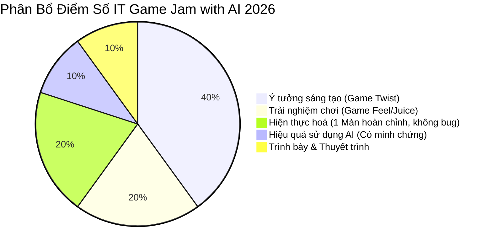

# 🚨 BỘ QUY TẮC TÁC CHIẾN (AGENT RULEBOOK) - IT GAME JAM 2026 (THREE.JS EDITION)
> **CHỈ THỊ HỆ THỐNG BẮT BUỘC (MANDATORY SYSTEM DIRECTIVE)**:  
> Dự án này sử dụng duy nhất nền tảng **Web Three.js (WebGL 3D / 2.5D) + HTML5/CSS3 UI Overlay + Web Audio API**.  
> **TUYỆT ĐỐI KHÔNG SỬ DỤNG UNITY HAY BẤT KỲ ENGINE NẶNG NỀ NÀO KHÁC.**  
> **BẤT KỲ AGENT NÀO (Antigravity, Codex, Cursor, Claude, ChatGPT, Grok)** khi tiếp quản dự án này trên máy thi **PHẢI TUÂN THỦ 100% CÁC NGUYÊN TẮC DƯỚI ĐÂY**.

---

## MỤC LỤC
1. [Thông Tin Cuộc Thi & Khống Chế Thiết Bị](#1-thông-tin-cuộc-thi--khống-chế-thiết-bị)
2. [Chi Tiết Tiêu Chí Đánh Giá & Cách Chấm Điểm Của BGK (100 Điểm)](#2-chi-tiết-tiêu-chí-đánh-giá--cách-chấm-điểm-của-bgk-100-điểm)
3. [Dây Chuyền 11 Prompt Tự Động Hóa (`prompt/`)](#3-dây-chuyền-11-prompt-tự-động-hóa-prompt)
4. [Phân Chia 3 Thành Viên Trên 1 Laptop Duy Nhất](#4-phân-chia-3-thành-viên-trên-1-laptop-duy-nhất)
5. [4 Đầu Ra (Outputs) Bắt Buộc Để Nộp Cho BTC](#5-4-đầu-ra-outputs-bắt-buộc-để-nộp-cho-btc)
6. [Cấu Trúc Dự Án & Khởi Chạy Trên Máy Mới (Zero Build-Time)](#6-cấu-trúc-dự-án--khởi-chạy-trên-máy-mới-zero-build-time)
7. [Quy Chuẩn Kiến Trúc Three.js WebGL 60FPS (Vibe Coding Rules)](#7-quy-chuẩn-kiến-trúc-threejs-webgl-60fps-vibe-coding-rules)
8. [Ma Trận Công Cụ AI: Quy Tắc Ngân Sách](#8-ma-trận-công-cụ-ai-quy-tắc-ngân-sách)
9. [Kịch Bản Pitching 90 Giây Chinh Phục Ban Giám Khảo](#9-kịch-bản-pitching-90-giây-chinh-phục-ban-giám-khảo)

---

## 1. THÔNG TIN CUỘC THI & KHỐNG CHẾ THIẾT BỊ

* **Tên cuộc thi**: `IT GAME JAM 2026 – WITH AI`
* **Đơn vị tổ chức**: LCĐ Khoa Công nghệ thông tin - Trường ĐH Khoa học, Đại học Huế.
* **Thời gian làm bài**: **Đúng 150 phút** (2.5 giờ).
* **Quy định thiết bị nghiêm ngặt**:
  * Mỗi đội thi (3 sinh viên) chỉ được mang **DUY NHẤT 01 LAPTOP VÀ 01 SẠC**.
  * Mang theo giấy A4 trắng trơn để làm nháp.
  * Thẻ sinh viên luôn đeo trên người.

---

## 2. CHI TIẾT TIÊU CHÍ ĐÁNH GIÁ & CÁCH CHẤM ĐIỂM CỦA BGK (100 ĐIỂM)

Ban Giám Khảo (BGK) chấm thi qua **2 vòng**:
* **Vòng Sơ loại (Tại bàn thi - 2 đến 3 phút)**: BGK đi từng bàn chấm trực tiếp. Game mở trên trình duyệt phải chạy mượt ngay lập tức, hướng dẫn phím bấm rõ ràng, không lỗi.
* **Vòng Chung kết (Top 3-5 trên màn hình lớn hội trường)**: Trình chiếu trước toàn bộ hội trường và khán giả.



### 1. Ý Tưởng Sáng Tạo — 40 Điểm (Tiêu chí quyết định giải Nhất)
* **Nội dung BGK đánh giá**: *"Điểm khác biệt trong cơ chế hoặc trải nghiệm, luật chơi kết hợp hợp lý, cách triển khai tạo ra lựa chọn hoặc thử thách thú vị."*
* **Nguyên tắc Agent**:
  - **CẤM LÀM GAME CLONE ĐƠN THUẦN**. Phải có **01 CÚ TWIST (cơ chế đảo ngược quy luật hoặc đánh đổi Risk vs Reward)**.
  - Tận dụng chiều sâu không gian 3D/2.5D, ánh sáng động (`PointLight`) hoặc góc nhìn Camera của Three.js để làm nổi bật Cú Twist.

### 2. Trải Nghiệm Chơi — 20 Điểm (Game Feel 3D & Độ Cuốn)
* **Nội dung BGK đánh giá**: *"Luật và mục tiêu dễ hiểu, sức hấp dẫn và động lực chơi tiếp hoặc chơi lại tốt."*
* **Nguyên tắc Agent**:
  - **Hiểu ngay trong 5 giây**: Dòng nhắc phím điều khiển (`[WASD] Di chuyển | [Chuột] Ngắm bắn 3D | [Space] Twist/Dash | [R] Chơi lại`) luôn hiển thị rõ trên HUD.
  - **Instant Restart (`0.01s`)**: Khi Game Over, bấm phím `R` là hàm `resetGame()` đưa thẳng vào trận mới ngay lập tức mà không reload lại trang web.
  - **3D Game Feel (Juice)**: Mọi phát bắn và va chạm phải có **3D Camera Shake**, **HitStop (dừng hình 0.04s)**, **Emissive White Flash**, **3D Debris Particle Explosion**, và **Âm thanh Web Audio Synth / CC0 SFX**.

### 3. Hiện Thực Hóa Ý Tưởng — 20 Điểm (Tính Trọn Vẹn & 60 FPS)
* **Nội dung BGK đánh giá**: *"Game khởi chạy và thao tác được, cơ chế chính hoạt động đúng, thể hiện được ý tưởng ban đầu. Một màn hoặc một vòng chơi hoàn chỉnh được xây dựng xong mới được chấp nhận."*
* **Nguyên tắc Agent**:
  - Khép kín 1 vòng chơi: `MENU -> PLAYING -> GAMEOVER / VICTORY -> HIGHSCORE -> INSTANT REPLAY`.
  - **0 Lỗi Console**: Tuyệt đối không để xảy ra lỗi `Uncaught TypeError` hay rò rỉ bộ nhớ WebGL.

### 4. Hiệu Quả Sử Dụng AI — 10 Điểm (Hồ Sơ Minh Chứng)
* **Nội dung BGK đánh giá**: *"Lựa chọn công cụ, công đoạn sử dụng phù hợp, có minh chứng kiểm tra, chỉnh sửa hoặc tích hợp đầu ra AI."*
* **Nguyên tắc Agent**:
  - Bắt buộc cập nhật file [AI_SHOWCASE/AI_REPORT.md](file:///d:/Project/game/AI_SHOWCASE/AI_REPORT.md) và lưu ảnh chụp màn hình quá trình chạy hệ thống Prompt vào `AI_SHOWCASE/Screenshots/`.

### 5. Trình Bày Và Giải Thích — 10 Điểm (Pitch 90s)
* Áp dụng kịch bản Pitch 4 bước (tạo tự động từ `prompt/03_presentation_prompt.md`).

### 6. Săn 02 Giải Yêu Thích Nhất (Sticker Khán Giả từ 15:00 - 17:00)
* Thành viên 2 dùng bút dạ vẽ Bảng bình chọn theo hướng dẫn từ `prompt/03_presentation_prompt.md`, kèm **Mã QR** (nếu push lên GitHub Pages) để khán giả quét chơi thử ngay trên điện thoại và dán sticker!

---

## 3. DÂY CHUYỀN 11 PROMPT TỰ ĐỘNG HÓA (`prompt/`)

Toàn bộ quy trình từ lúc nhận đề đến lúc tối ưu 100 điểm đã được đóng gói sẵn trong thư mục [prompt/](file:///d:/Project/game/prompt):
1. `01_subject_prompt.md`: Nhận Chủ đề BTC ➡️ Sinh `Gameplay Prompt` (Tree-of-Thoughts).
2. `02_gameplay_prompt.md`: Lưu trữ Hiến pháp Gameplay & Chuẩn hóa ý tưởng thô.
3. `03_presentation_prompt.md`: Sinh Tên game, Slogan, Thiết kế Bảng Vote bút dạ, Kịch bản Pitch 90s & nội dung `AI_REPORT.md`.
4. `04_style_prompt.md`: Khóa cứng phong cách Three.js 3D/2.5D, Ánh sáng, Bảng 6 mã màu HEX & Giao diện CSS UI.
5. `05_object_prompt.md`: Bộ 5 Prompt con (`5A` ➡️ `5E`) tạo thực thể Three.js `THREE.Group` / `SVG` / `PNG`.
6. `06_motion_prompt.md`: Biến thực thể thành 1 Module Diễn Hoạt 8 hướng / Hành động / VFX 3D.
7. `07_function_prompt.md`: Biên dịch Gameplay thành **Đặc tả Kỹ thuật Three.js Tuyệt đối (Zero-Ambiguity Spec)**.
8. `08_fix_prompt.md`: Bộ 3 Prompt con (**8A Bổ sung / 8B Sửa lỗi / 8C Xóa**) có khóa cô lập code.
9. `09_performance_prompt.md`: Kiểm định hiệu năng WebGL 60 FPS & Xuất Prompt tối ưu tự động.
10. `10_analyze_prompt.md`: Giám khảo AI chấm điểm dự án theo đúng **Rubric 100đ BTC** & Xuất khối đề xuất điền sẵn cho bước 08 và 11.
11. `11_detail_prompt.md`: Phẫu thuật vi mô CSS UI (`11A`) & Tinh chỉnh thông số/Mesh nhỏ (`11B`) với **Zero Blast-Radius**.

---

## 4. PHÂN CHIA 3 THÀNH VIÊN TRÊN 1 LAPTOP DUY NHẤT

1. **Thành viên 1 (Driver / Lead Three.js Vibe Coder)**:
   - Điều khiển laptop, chạy dây chuyền Prompt `01 -> 04 -> 07 -> Code Three.js -> 10 -> 08/11 -> 09`.
2. **Thành viên 2 (Creative / Voting Board Artist / Pitcher)**:
   - Phút 15: Lấy kết quả từ `03_presentation_prompt.md` ra giấy A4.
   - Phút 20 - 85: Vẽ **Bảng Bình Chọn Sticker** bằng bút dạ cực chất để đón khán giả lúc 15h00.
   - Phút 85 - 150: Học thuộc và diễn tập bài Pitch 90 giây.
3. **Thành viên 3 (QA / Asset Crafter / AI Logger)**:
   - Chạy các prompt tạo hình `05_object_prompt.md` & `06_motion_prompt.md`, chọn file âm thanh từ `Assets/audio/sfx/`.
   - Playtest tìm bug, chụp ảnh màn hình prompt và hoàn thiện `AI_SHOWCASE/AI_REPORT.md` (10đ AI).

---

## 5. 4 ĐẦU RA (OUTPUTS) BẮT BUỘC ĐỂ NỘP CHO BTC

1. **Output 1 - Bản Game Web Three.js Hoàn Chỉnh**: Chạy trực tiếp từ `index.html` (và/hoặc link GitHub Pages), 60 FPS, có hướng dẫn phím bấm, tính điểm, thắng/thua, phím `R` chơi lại.
2. **Output 2 - Hồ Sơ Minh Chứng AI (10đ)**: Thư mục `AI_SHOWCASE/` gồm `AI_REPORT.md` và ảnh chụp màn hình các bước Prompt.
3. **Output 3 - Bảng Bình Chọn Vật Lý**: Vẽ bằng bút dạ đặt tại khu vực bình chọn.
4. **Output 4 - Bài Thuyết Trình 90 Giây**: Trình diễn trực tiếp cho BGK.

---

## 6. CẤU TRÚC DỰ ÁN & KHỞI CHẠY TRÊN MÁY MỚI (ZERO BUILD-TIME)

```text
gamejam-husc/
├── index.html                  <-- TRÁI TIM DỰ ÁN: Game Three.js WebGL + CSS UI + Web Audio
├── RULE.md                     <-- Kim chỉ nam bắt buộc cho mọi AI Agent
├── .cursorrules                <-- Chỉ thị tự động cho IDE Agent (Cursor / Windsurf / Antigravity)
├── prompt/                     <-- Dây chuyền 11 Prompt tối ưu hóa (00 -> 11)
├── Assets/
│   ├── audio/
│   │   ├── sfx/                <-- Kho 303 file âm thanh CC0 (.ogg) phân loại sẵn
│   │   └── bgm/                <-- Nhạc nền BGM
│   ├── fonts/                  <-- Kho 11 Font Pixel/Retro/Future (.ttf)
│   └── textures/               <-- Nơi lưu SVG / PNG textures nếu cần
└── AI_SHOWCASE/
    ├── AI_REPORT.md            <-- Báo cáo minh chứng AI (10 điểm)
    └── Screenshots/            <-- Ảnh chụp màn hình lịch sử Prompt
```

### Cách mở game chạy ngay trong 2 giây trên máy thi:
* **Cách 1 (VS Code Live Server)**: Chuột phải vào `index.html` ➡️ Chọn **"Open with Live Server"**.
* **Cách 2 (Python Local Server)**: Mở Terminal tại thư mục dự án, chạy:
  ```bash
  python -m http.server 8000
  ```
  Sau đó mở trình duyệt truy cập `http://localhost:8000`.

---

## 7. QUY CHUẨN KIẾN TRÚC THREE.JS WEBGL 60FPS (VIBE CODING RULES)

Mọi Agent khi viết hoặc sửa code trong `index.html` / `.js` **BẮT BUỘC TUÂN THỦ**:

1. **Không gian & Tọa độ Chuẩn**:
   - Mặt sàn đấu chính nằm trên mặt phẳng **`XZ` (`Y = 0`)**, trục `+Y` hướng lên trời.
   - Dùng `THREE.Raycaster` chiếu chuột xuống mặt phẳng `new THREE.Plane(new THREE.Vector3(0, 1, 0), 0)` để ngắm bắn 3D chính xác tuyệt đối.
2. **Quản lý Bộ nhớ VRAM (Zero Memory Leak)**:
   - Dùng chung (Shared/Cached) `THREE.BufferGeometry` và `THREE.Material` cho đạn, hạt nổ và quái cùng loại.
   - Khi xóa đối tượng hoặc khi gọi `resetGame()` (Phím `R`), BẮT BUỘC gọi `scene.remove(mesh)` và dọn sạch mảng.
3. **Độc lập Tốc độ Khung hình (Delta-Time Clamping)**:
   - Luôn kẹp `const dt = Math.min(clock.getDelta(), 0.05);` để tránh lỗi nhảy vọt vị trí khi chuyển tab.
4. **Hiệu ứng 3D Game Feel Bắt Buộc**:
   - Mọi tương tác chiến đấu phải kích hoạt: `triggerShake(intensity, duration)`, `triggerHitStop(seconds)`, `spawn3DParticles(pos, color, count)`, và `SoundSynth.play(...)`.
5. **Giao diện HTML5/CSS3 Overlay**:
   - Lớp `#uiLayer` phủ trên Canvas phải đặt `pointer-events: none;`, chỉ các nút `<button>` mới đặt `pointer-events: auto;` để không cản trở chuột xoay/bắn trong không gian 3D.

---

## 8. MA TRẬN CÔNG CỤ AI: QUY TẮC NGÂN SÁCH

* **Bản trả phí đã có**: **Antigravity** (Lead Three.js Architect & File Operator) + **Codex / Copilot** (Inline Autocomplete).
* **Bản miễn phí 100% kết hợp**:
  - **Claude 3.5/4 Sonnet & ChatGPT-4o**: Chạy dây chuyền Prompt `01 -> 07 -> 10`.
  - **Grok**: Chạy `03_presentation_prompt.md` lấy tên game meme, slogan câu vote.
  - **Kho `Assets/audio/sfx/` + Web Audio API Synth**: Âm thanh 0 giây chờ đợi.
  - **Suno.com (Free) / BeepBox.co**: Tạo nhạc nền BGM.

---

## 9. KỊCH BẢN PITCHING 90 GIÂY CHINH PHỤC BAN GIÁM KHẢO

1. **[00s - 15s] Hook & Chủ đề**: *"Chào thầy cô và BGK, từ chủ đề [X], đội em mang đến [Tên Game] - một tựa game Web 3D Three.js với cú Twist ngược đời: [Mô tả Twist trong 1 câu]"*.
2. **[15s - 45s] Live 3D Gameplay**: *"Ngay trên trình duyệt không cần cài đặt, người chơi điều khiển trong không gian 3D với ánh sáng động, hiệu ứng nổ mảnh vỡ 3D và sự đánh đổi sinh tử mỗi giây..."*.
3. **[45s - 75s] Dây chuyền Prompt 11 Bước (10đ AI)**: *"Đội em đã xây dựng một kiến trúc 11 Prompt tuần tự từ Subject, Style Lock, Zero-Ambiguity Spec đến Performance Audit, và trực tiếp kiểm định toán học 3D để khóa cứng 60 FPS"*.
4. **[75s - 90s] Mời Trải nghiệm**: *"Mời thầy cô chạm tay chơi thử! Bấm R là hồi sinh tức khắc trong 0.01 giây!"*.
