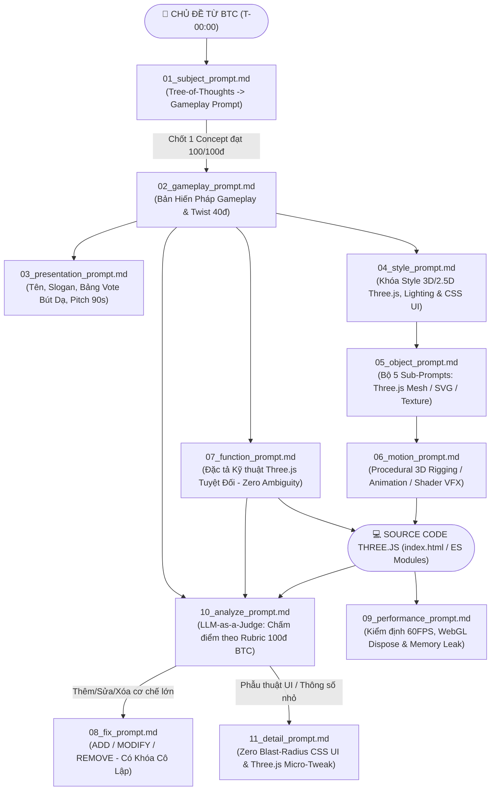

# 🧠 HỆ THỐNG PROMPT TÁC CHIẾN TỐI THƯỢNG (THREE.JS WEBGL EDITION) - IT GAME JAM 2026

> **Kiến trúc Prompt Engineering Cấp Độ Production (Constitutional AI + Chain-of-Thought + Few-Shot + XML Schema)**  
> Toàn bộ hệ thống 11 loại Prompt trong thư mục `prompt/` này đã được tối ưu hóa ở mức cao nhất cho nền tảng **Web Three.js (WebGL 3D / 2.5D + HTML5/CSS3 UI Overlay + Web Audio API)** — loại bỏ 100% sự phụ thuộc vào game engine nặng nề, thời gian build bằng 0 giây, F5 chạy tức thì trong 0.01s.

---

## 🗺️ 1. SƠ ĐỒ ĐƯỜNG ỐNG KẾT HỢP PROMPT (THE 11-STAGE PROMPT PIPELINE)



---

## 📊 2. MA TRẬN KỸ THUẬT PROMPT ENGINEERING ĐƯỢC ÁP DỤNG

Mỗi file từ `01` đến `11` đều được cấu trúc theo tiêu chuẩn **Instruction Hierarchy** cao cấp nhất:
1. **`<system_role>` & `<context_constraints>`**: Định vị chuyên gia hẹp (Principal Three.js Architect, Game Jam Director, LLM-as-a-Judge) và khóa chặt ràng buộc 150 phút / 1 Laptop.
2. **`<reasoning_protocol>` (Chain-of-Thought & Tree-of-Thoughts)**: Bắt buộc AI phải suy luận từng bước, tự so sánh các nhánh giải pháp và kiểm tra công thức toán học trước khi viết code.
3. **`<few_shot_calibration>` (Show, Don't Tell)**: Cung cấp cặp ví dụ đối chiếu **`[SAI / MƠ HỒ]` vs `[ĐÚNG / CHUẨN THREE.JS]`** ngay trong prompt để triệt tiêu 100% hiện tượng AI trả lời chung chung.
4. **`<constitutional_guardrails>` (Self-Critique & Isolation Lock)**: Tự động rà soát lỗi rò rỉ VRAM WebGL (`geometry.dispose()`, `material.dispose()`), kẹp trần `dt = Math.min(clock.getDelta(), 0.05)` và cô lập vùng sửa.
5. **`<output_contract>`**: Ép định dạng đầu ra cố định để copy-paste trực tiếp làm Input cho bước kế tiếp.

---

## 🛠️ 3. KHỐI NGỮ CẢNH CƠ SỞ & META-PROMPT ENHANCER (DÙNG KHI MỞ TAB CHAT MỚI)

> **Hướng dẫn**: Copy khối dưới đây dán vào đầu bất kỳ phiên chat mới nào trên **Claude 3.5/4 Sonnet, ChatGPT-4o/o1, Grok, Gemini** hoặc khi bạn muốn nhờ AI **tối ưu/mở rộng thêm một prompt bất kỳ**:

```xml
<base_jam_context>
  <competition>IT GAME JAM WITH AI 2026 - ĐH Khoa học, ĐH Huế (150 phút, 1 Laptop, 3 Thành viên)</competition>
  <tech_stack>
    - Core Engine: Web Three.js (ES Module / WebGLRenderer, 60 FPS, Zero build-time).
    - Visuals: Procedural Three.js 3D/2.5D Meshes (THREE.Group, BufferGeometry, MeshStandardMaterial/MeshToonMaterial, PointLight/DirectionalLight, Post-processing Bloom, InstancedMesh particles) kết hợp SVG/CanvasTexture.
    - UI Layer: HTML5 + CSS3 Overlay nằm đè trên Canvas WebGL (Pointer-events tối ưu, Glassmorphism / Retro Arcade CSS).
    - Audio Layer: Web Audio API Procedural Synthesizer kết hợp kho 300+ file âm thanh CC0 (.ogg) trong thư mục `assets/audio/sfx/` và font trong `assets/fonts/`.
  </tech_stack>
  <scoring_rubric total="100">
    - Ý tưởng sáng tạo (40đ): Bắt buộc có 1 CÚ TWIST độc đáo trong cơ chế, tạo sự đánh đổi (Risk vs Reward) thú vị.
    - Trải nghiệm chơi (20đ): Luật hiểu ngay trong 5s, Game Feel/Juice đỉnh cao (3D Camera Shake, HitStop time-scale freeze, 3D Particle burst, Dynamic FOV/Light flash), phím [R] chơi lại tức thì trong 0.01s.
    - Hiện thực hóa (20đ): Hoàn chỉnh 1 vòng chơi khép kín (Menu -> Play -> Win/Lose -> HighScore -> Instant Replay), 0 lỗi Console.
    - Hiệu quả AI (10đ): Lưu vết prompt và minh chứng tinh chỉnh trong `AI_SHOWCASE/AI_REPORT.md`.
    - Trình bày & Giải thích (10đ): Pitch 90 giây trực diện, cuốn hút.
    - Giải phụ: 02 Giải Yêu Thích Nhất (Khán giả dán sticker lên bảng vẽ bút dạ + quét QR chơi thử từ 15h00 - 17h00).
  </scoring_rubric>
</base_jam_context>

<meta_prompt_enhancer_directive>
Nếu tôi gửi kèm một bản nháp yêu cầu và nói "ENHANCE PROMPT", hãy đóng vai Principal Prompt Architect:
1. Giữ nguyên ý đồ cốt lõi nhưng bọc toàn bộ vào cấu trúc thẻ XML (<role>, <context>, <thinking_steps>, <constraints>, <output_format>).
2. Thay thế mọi tính từ cảm tính bằng thông số kỹ thuật Three.js / Toán học 3D tường minh (Vector3, Euler, Quaternion, Lerp, Raycaster, BoundingSphere).
3. Bổ sung bước <self_critique> ở cuối để AI nhận lệnh phải tự kiểm tra trước khi xuất kết quả.
</meta_prompt_enhancer_directive>
```
