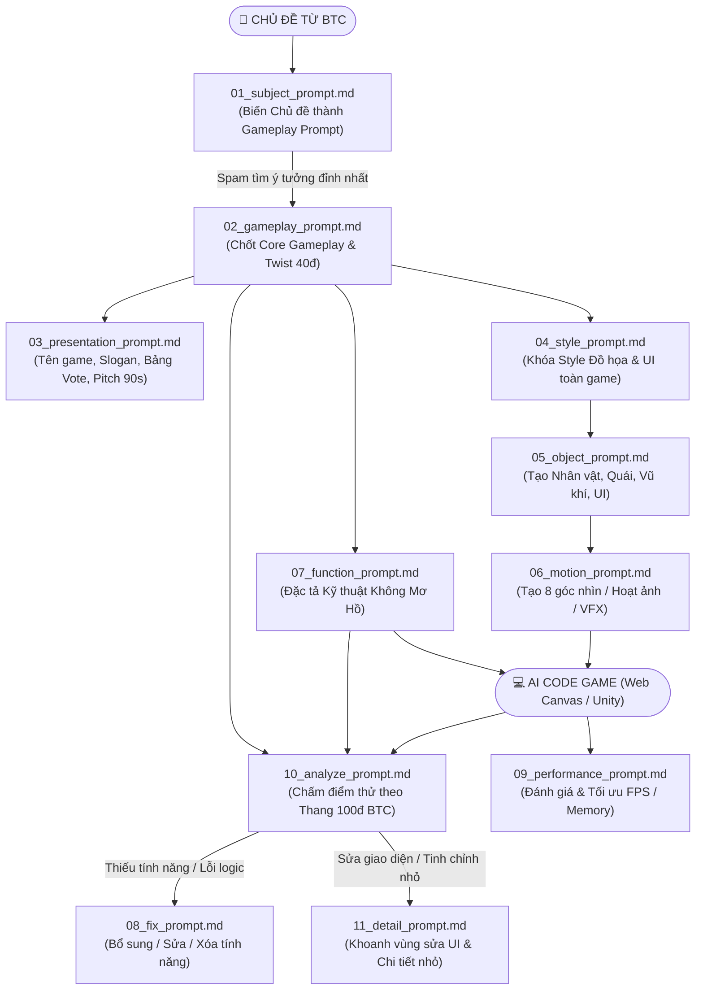

# 🧠 HỆ THỐNG PROMPT TÁC CHIẾN (PROMPT ENGINEERING ARSENAL) - IT GAME JAM 2026

Thư mục `prompt/` này là **dây chuyền sản xuất game tự động hoá bằng AI** được thiết kế riêng cho cuộc thi **IT GAME JAM 2026 (150 phút - 1 Laptop)**. Toàn bộ 11 loại prompt được kết nối với nhau thành một đường ống (Pipeline) khép kín: đầu ra (Output) của prompt trước chính là đầu vào (Input) của prompt sau.

---

## 🗺️ SƠ ĐỒ LUỒNG KẾT HỢP CÁC PROMPT (PROMPT PIPELINE)



---

## 📋 DANH MỤC 11 FILE PROMPT TRONG THƯ MỤC NÀY

| STT | Tên File | Tên Gọi | Mục Đích Cốt Lõi |
| :-: | :--- | :--- | :--- |
| **01** | `01_subject_prompt.md` | **Subject Prompt** | Nhận chủ đề BTC ➡️ Sinh ra một `Gameplay Prompt` bám sát thang điểm 100. |
| **02** | `02_gameplay_prompt.md` | **Gameplay Prompt** | Khuôn mẫu & Prompt chốt cơ chế chơi, cú Twist (40đ), luật thắng/thua, tính điểm. |
| **03** | `03_presentation_prompt.md` | **Presentation Prompt** | Sinh tên game, slogan, hướng dẫn vẽ Bảng Bình Chọn bút dạ, kịch bản Pitch 90s. |
| **04** | `04_style_prompt.md` | **Style Prompt** | Đúc kết & **Khóa phong cách nghệ thuật + UI** toàn game (Palette, Nhân vật, Quái, Popup, Bar). |
| **05** | `05_object_prompt.md` | **Object Prompt** | Bộ 5 Sub-Prompts tạo từng thực thể riêng (Player, Enemy, Weapon, Item, UI) theo định dạng SVG/PNG/Canvas. |
| **06** | `06_motion_prompt.md` | **Motion Prompt** | Biến Object thành Sprite Sheet 4-8 hướng (Top-down), hoạt ảnh (Side-scroll) hoặc Procedural Motion. |
| **07** | `07_function_prompt.md` | **Function Prompt** | Biến Gameplay thành **Tài liệu Đặc tả Kỹ thuật Tuyệt đối** (Zero-Ambiguity Spec) để AI code không lệch ý. |
| **08** | `08_fix_prompt.md` | **Fix Prompt** | Bộ 3 Sub-Prompts (**Bổ sung / Sửa / Xóa** tính năng lớn) có khóa cô lập code. |
| **09** | `09_performance_prompt.md` | **Performance Prompt** | Khám bệnh hiệu năng (FPS, Memory Leak, Collision) ➡️ Xuất Báo cáo + Prompt sửa lỗi. |
| **10** | `10_analyze_prompt.md` | **Analyze Prompt** | Giám khảo AI chấm điểm dự án theo đúng **Rubric 100 điểm của BTC** (Dùng được từ lúc lên ý tưởng đến lúc code xong). |
| **11** | `11_detail_prompt.md` | **Detail Prompt** | Phẫu thuật vi mô: Khoanh vùng cực hẹp để chỉnh sửa UI, màu sắc, thông số nhỏ mà **không bao giờ lan sang code khác**. |

---

## 🛠️ KHỐI NGỮ CẢNH CƠ SỞ & META-PROMPT ENHANCER (DÙNG CHUNG)

> **Khi nào dùng khối này?**  
> Khi bạn mở một tab hội thoại mới trên **ChatGPT, Claude, Gemini, Grok** hoặc khi bạn muốn nhờ một AI **nâng cấp/tinh chỉnh lại một prompt bất kỳ** cho sắc bén hơn mà không muốn phải gõ lại luật thi từ đầu. Hãy copy đoạn dưới đây dán lên đầu:

```text
=== [BASE CONTEXT: IT GAME JAM 2026 - HUSC] ===
- Cuộc thi: IT Game Jam with AI 2026 (150 phút phát triển trên 1 laptop duy nhất, đội 3 người).
- Nền tảng mục tiêu: Ưu tiên số 1 là Web Game (HTML5 Canvas / JS / CSS / Web Audio API gói gọn, chạy tức thì, không tốn thời gian build) hoặc Unity 6 2D.
- Cơ cấu chấm điểm của Ban Giám Khảo (100 điểm):
  1. Ý tưởng sáng tạo (40đ): Phải có 1 CÚ TWIST độc đáo trong cơ chế, luật chơi kết hợp hợp lý, tạo thử thách/lựa chọn thú vị.
  2. Trải nghiệm chơi (20đ): Luật dễ hiểu trong 5 giây, có Game Feel/Juice (Screen Shake, HitStop, Particle, âm thanh nịnh tai), bấm phím R chơi lại ngay lập tức (0.01s).
  3. Hiện thực hóa (20đ): Hoàn chỉnh 1 vòng chơi khép kín (Menu -> Play -> Win/Lose -> Score/Highscore -> Replay), 0 bug, không crash.
  4. Hiệu quả sử dụng AI (10đ): Có minh chứng prompt, kiểm tra và tinh chỉnh đầu ra AI.
  5. Trình bày & Giải thích (10đ): Pitch 90 giây rõ ràng, thuyết phục.
  + Giải phụ quan trọng: 02 Giải Yêu Thích Nhất (Khán giả dán sticker lên bảng vẽ bằng bút dạ từ 15h00 - 17h00).

=== [META-PROMPT ENHANCER INSTRUCTION (CHỈ DÙNG KHI CẦN TỐI ƯU PROMPT)] ===
Nếu tôi yêu cầu bạn "Tối ưu / Nâng cấp Prompt", hãy đóng vai Principal Prompt Engineer: giữ nguyên cấu trúc Input/Output của tôi, làm sắc bén các thuật ngữ kỹ thuật, loại bỏ hoàn toàn sự mơ hồ (zero ambiguity) để bất kỳ LLM nào đọc vào cũng thực thi chính xác 100% theo đúng 1 cách hiểu duy nhất.
```
